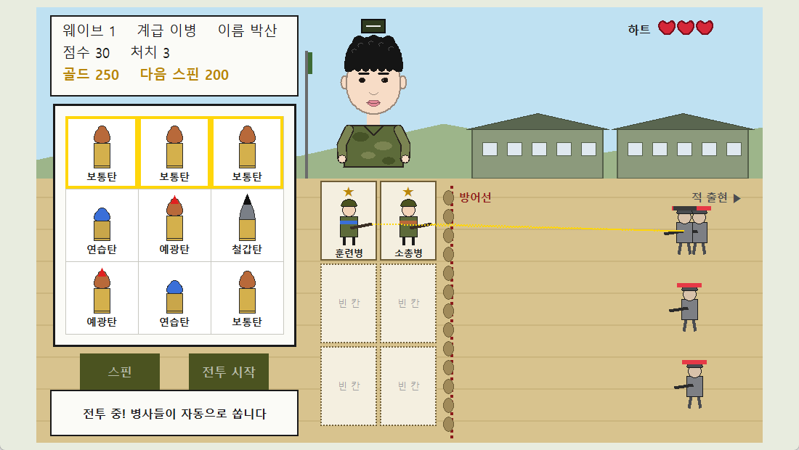
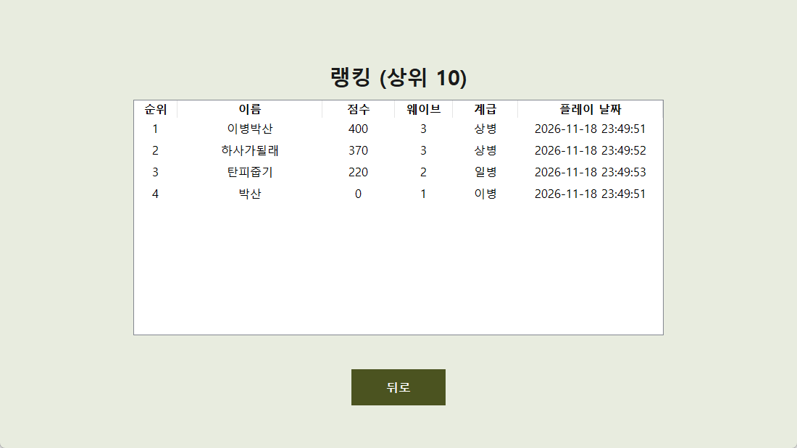
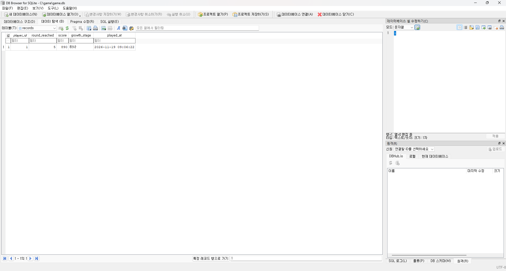

# 박산 키우기

슬롯머신을 돌려 점수를 모으고, 라운드를 통과할 때마다 박산이 한 계급씩 진급하며 얼굴이 바뀌는 로그라이크 게임이다.



## 과제 제출물 바로가기

| 제출물 | 위치 |
|---|---|
| 1. 기획서 | [기획서.md](./기획서.md) |
| 2. 코드 | [src 폴더](./src) |
| 3. 실행파일 | Release 링크(공개 후 채움) |
| 4. 깃 주소 | 현재 저장소 |

## DB 연동

- 사용 DB: SQLite (파이썬 표준 라이브러리 `sqlite3`)
- 파일: `game.db` (실행하면 자동으로 생긴다. exe로 실행하면 exe 옆, 소스로 실행하면 `src/` 안)
- 테이블 생성 SQL 전체: [schema.sql](./schema.sql)
- 모든 SQL은 `?` 자리표시자로 값을 넘긴다. SQL은 [src/db.py](./src/db.py) 한 파일에만 있다.

### 테이블 구조

**players** (플레이어)

| 컬럼 | 형식 | 설명 |
|---|---|---|
| id | INTEGER PK | 플레이어 번호 (자동 증가) |
| name | TEXT UNIQUE NOT NULL | 플레이어 이름 (같은 이름은 같은 플레이어, 빈 이름 불가) |
| created_at | TEXT NOT NULL | 처음 등록한 시각 |

**records** (게임 기록)

| 컬럼 | 형식 | 설명 |
|---|---|---|
| id | INTEGER PK | 기록 번호 (자동 증가) |
| player_id | INTEGER FK → players.id | 누가 플레이했는지 |
| round_reached | INTEGER NOT NULL | 도달한 라운드 |
| score | INTEGER NOT NULL | 총점 |
| growth_stage | TEXT NOT NULL | 계급 (이병/일병/상병/병장/하사) |
| played_at | TEXT NOT NULL | 플레이한 시각 |

### DB 동작

| 시점 | 동작 | SQL | 코드 위치 |
|---|---|---|---|
| 프로그램 시작 | 테이블 생성 | CREATE TABLE IF NOT EXISTS | [db.py init_db()](./src/db.py#L52-L62) |
| 게임 시작 | 플레이어 등록/조회 | SELECT / INSERT | [db.py get_or_create_player()](./src/db.py#L78-L85) |
| 게임 오버 | 기록 저장 | INSERT | [db.py save_record()](./src/db.py#L88-L104) |
| 랭킹 화면 | 상위 10개 조회 | SELECT ... ORDER BY ... LIMIT 10 | [db.py get_top10()](./src/db.py#L107-L125) |

게임 안 랭킹 화면 (DB에서 읽은 상위 기록):



DB Browser for SQLite로 연 game.db:



## 과제 정보

한국폴리텍대학 인천캠퍼스 컴퓨터공학과 / 파이썬 기말과제 / 백준엽

## 실행 방법

1. **실행파일**: Release에서 `박산키우기.exe`를 받아 실행한다. Python이 없어도 된다.
   - Windows "PC 보호" 창이 뜨면 **추가 정보 → 실행**을 누른다. 서명하지 않은 과제용 프로그램이라 뜨는 경고다.
2. **소스로 실행**: Python 3.11 이상이 필요하다.
   ```
   python src/main.py
   ```
   (Windows에서는 `py src/main.py`도 된다. 화면 없이 규칙만 보려면 `python src/game.py`)

## 코드 구성

| 파일 | 역할 | 주요 함수 |
|---|---|---|
| [src/symbols.py](./src/symbols.py) | 총알 5종·계급 5단계 정의, 총알 그리기 | `draw_bullet`, `draw_highlight` |
| [src/game.py](./src/game.py) | 게임 규칙 (화면과 분리) | `target_score`, `count_lines`, `spin_score`, `clean_name`, `Game.spin`, `Game.finish_round`, `Game.shop_offer` |
| [src/character.py](./src/character.py) | 캐릭터를 코드로 그리기, 얼굴 섞기, 춤 순서, 말풍선 | `face_for`, `draw_character`, `draw_rank_badge`, `draw_bubble` |
| [src/db.py](./src/db.py) | sqlite3 연동 | `init_db`, `get_or_create_player`, `save_record`, `get_top10` |
| [src/ui.py](./src/ui.py) | tkinter 화면 5개 | `App.show_start`, `App.show_game`, `App.on_spin`, `App.start_dance`, `App.show_gameover`, `App.show_ranking` |
| [src/main.py](./src/main.py) | 진입점 | `main` |
| [tests/](./tests) | pytest 테스트 | 규칙·DB·그림·화면·DB 실패·자동 한 판 |

읽는 순서: symbols.py → game.py → character.py → db.py → ui.py → main.py

캐릭터는 실제 인물 사진이 아닌, 코드로 그린 그림이다 ([character.py](./src/character.py)).

### 폴더 구조
```
baksan-growing/
├── README.md, 기획서.md, schema.sql, build.bat, requirements.txt, requirements-dev.txt
├── src/          main.py, game.py, ui.py, db.py, symbols.py, character.py
├── tests/        pytest 테스트와 확인용 도구
├── images/       game.png, ranking.png, db_browser.png, faces_preview.png, dance_preview.png
└── docs/         request.md(처음 요청서 원문)와 작업 문서
```

### 테스트 실행
```
pip install -r requirements-dev.txt
pytest tests
```

### exe 만들기
`build.bat`을 실행하면 `dist/박산키우기.exe`가 생긴다.

## 사용 기술

Python, tkinter, sqlite3, PyInstaller
