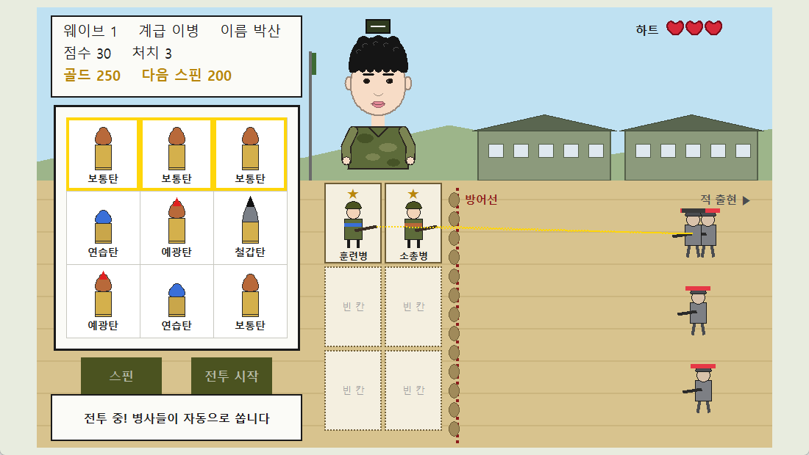
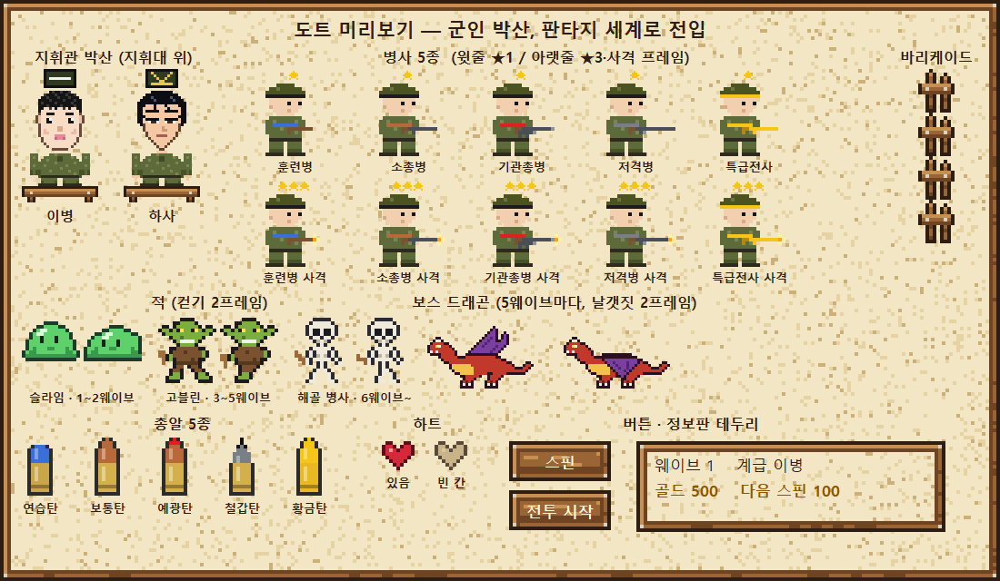
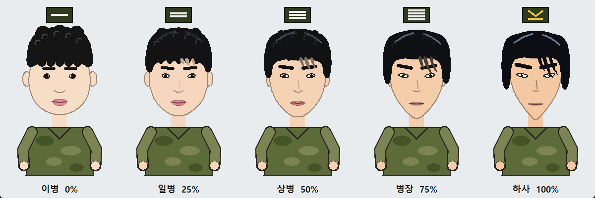
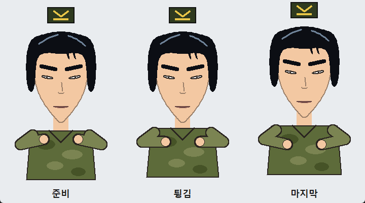
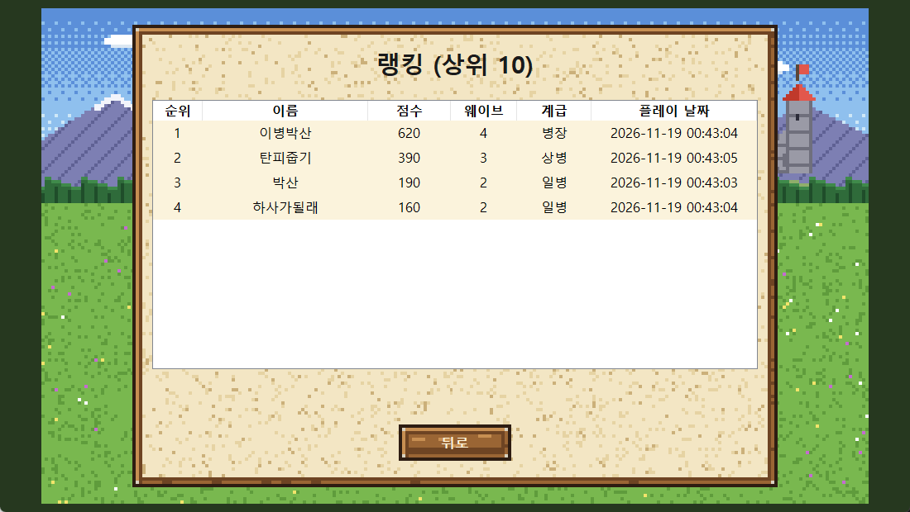
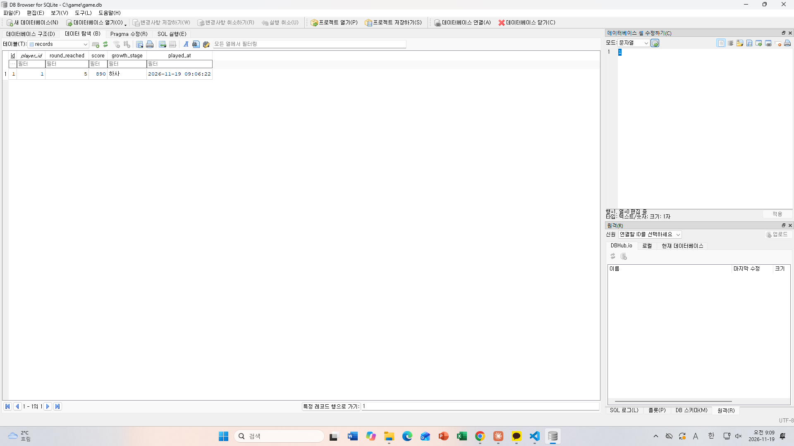

# 박산 키우기 — 기획서

## 1) 프로젝트 개요
- 게임 이름: 박산 키우기
- 한 줄 소개: 슬롯을 돌려 병사를 소환하고, 같은 병사를 합체해 키우며, 자동 전투로 적의 웨이브를 막는 슬롯 디펜스 로그라이크다. 웨이브를 막을 때마다 박산이 한 계급씩 진급하며 얼굴이 바뀐다.
- 설정: 군인 박산과 부대원들이 판타지 세계로 전입해 몬스터 웨이브를 막는다. 박산과 병사들은 군복 차림 그대로이고, 하늘·산·성·숲·풀밭이 있는 세계에서 나무 바리케이드를 방어선 삼아 슬라임·고블린·해골 병사와 5웨이브마다 나타나는 드래곤을 상대한다.
- 만든 목적: 파이썬 수업 기말과제다. 배포용이 아니며 기능은 최소한으로, 코드는 읽기 쉽게 만든다.
- 그래픽은 판타지 분위기의 2D 도트(픽셀 아트)다. 도트는 파이썬 코드(`src/pixel_art.py`: 글자 격자 + 색표)로 직접 찍어 tkinter PhotoImage로 만든다. 이미지·영상·음악 파일, 외부·AI 생성 그림, 다른 게임의 이름·이미지·사운드는 쓰지 않는다. 글자는 한글이 잘 읽히게 맑은 고딕을 쓴다.
- 캐릭터는 실제 인물 사진이 아닌 코드로 그린 그림이다.

## 2) 개발 환경
| 항목 | 내용 |
|---|---|
| 언어 | Python 3.11 이상 (개발 PC는 3.14) |
| 화면(GUI) | tkinter (표준 라이브러리), 그림은 Canvas + 코드로 찍은 도트 PhotoImage |
| DB | SQLite, sqlite3 (표준 라이브러리) |
| 실행파일 | PyInstaller 6.22.3 (Windows용 단일 exe, `박산키우기.exe`, [build.bat](./build.bat)) |
| 테스트 | pytest (개발용, [requirements-dev.txt](./requirements-dev.txt)) |
| OS | Windows 11 |

게임 코드는 표준 라이브러리만 쓴다. PyInstaller는 exe를 만들 때, pytest는 테스트할 때만 쓴다.

## 3) 게임 규칙

### 총알 = 병사 (5종)
슬롯 칸에 나오는 심볼은 총알이고, 총알 종류마다 소환되는 병사가 정해져 있다. 이모지나 이미지 파일을 쓰지 않고 코드로 찍은 도트 그림으로 그린다.

| 총알 | 모양 | 병사 | 초당 공격력 (★1) |
|---|---|---|---|
| 연습탄 | 짧은 탄, 파란 탄두 | 훈련병 | 5 |
| 보통탄 | 기본 탄, 구리색 탄두 + 놋쇠색 탄피 | 소총병 | 10 |
| 예광탄 | 보통탄 모양, 탄두 끝만 빨강 | 기관총병 | 15 |
| 철갑탄 | 길고 뾰족한 탄두, 끝이 검정 | 저격병 | 25 |
| 황금탄 | 전체 금색, 상점에서만 얻는다 | 특급전사 | 40 |

- 칸마다 총알 그림과 그 아래 이름 글자("연습탄" 등)를 함께 그린다. 색만으로 구분하지 않으므로 빨강·초록을 구분하기 어려운 사람도 모양과 글자로 알아볼 수 있다.
- 칸은 가로·세로 100px로 고정해 창이 가장 작을 때도 80px 이상이다. 기본 총알(보통탄)은 칸 높이의 약 60%이고, 이름 글자는 14px 이상 굵은 글씨다.
- 같은 총알 3개가 한 줄로 맞으면 그 줄의 칸 테두리를 두꺼운 노란 선으로 강조한다. 테두리만 칠하므로 총알 그림은 가려지지 않는다.
- 총알을 그리는 함수(`draw_bullet`)는 총알 정의와 같은 파일인 [src/symbols.py](./src/symbols.py)에 둔다. 도트 이미지를 만드는 pixel_art는 그릴 때만 불러오므로, [src/game.py](./src/game.py)는 화면 없이도 symbols.py를 쓸 수 있다.

### 덱(총알 풀)
- 처음 덱은 총알 10개다.

| 총알 | 처음 개수 |
|---|---|
| 연습탄 | 4 |
| 보통탄 | 3 |
| 예광탄 | 2 |
| 철갑탄 | 1 |
| 황금탄 | 0 (상점에서만) |

- 스핀하면 9칸 각각에 덱에서 총알 하나를 무작위로 뽑는다. 같은 총알이 여러 개 있으면 그만큼 잘 나온다.

### 한 판의 흐름
```
[준비 단계] 골드로 스핀 → 맞은 줄마다 병사 소환·합체 → [전투 시작]
   ▼
[전투] 적이 오른쪽에서 걸어오고 병사가 자동으로 쏜다 → 모두 처치하거나 지나가면 웨이브 끝
   ▼ 하트가 남아 있으면
[웨이브 끝] 골드 보상 → 진급 + 춤 → [상점] 3개 중 1개 무료 → 다음 웨이브의 [준비 단계]
   (하트가 0 이하가 되면 게임 오버)
```
아래 숫자는 처음값이다. 구현 뒤 300판 시뮬레이션으로 평균 4~6웨이브, 하사 도달 30~40% 안팎이 되게 조정했다.

**난이도 조정값 (2026-11-19 갱신, `tests/tools/simulate.py` 300판 × 상점 전략 2가지)**
| 숫자 | 값 | 비고 |
|---|---|---|
| 전장 길이 | 100 | 적이 나오는 곳 ~ 방어선 |
| 적 속도 ([enemy_speed()](./src/game.py#L81-L83)) | 5 + 10 × (웨이브 − 1), 최대 33 (1초에 걷는 거리) | 1웨이브 5(방어선까지 20초), 2웨이브 15(약 6.7초), 3웨이브 25(4초), 4웨이브부터 33(약 3.03초) |
| 적 나오는 간격 | 0.30초 | 처음값 1초 → 0.35초(속도 상한) → 0.30초(지원군) |
| 1웨이브 지원군 | 1웨이브를 병사 0명으로 시작하면 훈련병★1 1명 | 2026-11-19 사장 승인 (아래 "전투") |
| 적 수·체력 | 아래 "전투"의 식 그대로 | 바꾸지 않음 |

- **속도 상한 (사장 판단)**: 어느 웨이브에서도 적이 방어선까지 3초 이상 걸려야 한다. 전장 100 ÷ 3초 ≈ 33.3 → 상한 33 (100 ÷ 33 ≈ 3.03초). 확인 테스트 `tests/test_speed_cap.py`(3웨이브 25 / 4·5웨이브 33 / 1000웨이브 33, 실제 전투 3초).
- 느려진 만큼 쉬워진 것은 적 나오는 간격으로 맞췄다(1초 → 0.35초: 적이 몰려와 병사 공격력이 나뉜다). 간격만으로 목표에 들어와 적 수·체력은 그대로 뒀다.
- **1웨이브 지원군 (2026-11-19 사장 승인)**: 1웨이브 탈락 10~11%는 모두 스핀 3번이 꽝이라 병사 0명인 판이었다. 그래서 1웨이브를 병사 0명으로 시작하면 지원군 훈련병★1이 오게 하고, 그만큼 쉬워진 것은 적 간격 0.35 → 0.30초로 맞췄다. 확인 테스트 `tests/test_reinforce.py`.

| 상점 선택 | 평균 도달 웨이브 | 하사 도달 | 1웨이브 탈락 |
|---|---|---|---|
| 아무거나 | 4.36 | 36% | 0% |
| 가장 좋은 것 | 4.48 | 33% | 0% |

(지원군 전 2026-11-18 값: 아무거나 4.58·39%·10%, 가장 좋은 것 4.74·38%·11%)

- 처음 조정(속도 최대 185, 4웨이브부터 0.54초 만에 통과)은 눈으로 따라가기 어려워 위처럼 바꿨다.

### 준비 단계 (스핀)
- 시작 골드 500, 하트 3 (최대 5).
- 스핀 비용은 준비 단계마다 100에서 시작해 스핀할 때마다 50씩 오른다 (100 → 150 → 200 …). 골드가 비용보다 적으면 스핀할 수 없다 (골드가 비용과 같으면 스핀할 수 있다).
- 스핀하면 9칸 각각에 덱에서 총알 하나를 무작위로 뽑는다.
- 가로 3줄, 세로 3줄, 대각선 2줄(모두 8줄) 중 같은 총알 3개가 맞은 줄 하나마다 그 총알의 병사 1명을 소환한다. 한 칸이 여러 줄에 속해도 줄마다 따로 센다. 맞은 줄이 없으면 꽝이다.
- [전투 시작]을 누르면 전투로 넘어간다. 병사가 0명이어도 전투를 시작할 수 있다.

### 병사와 합체
- 병사 칸은 6개다.
- 같은 종류·같은 별의 병사가 2명이 되면 바로 합체해 별이 하나 오른다 (★1 → ★2 → ★3). 합체한 병사가 또 같은 짝을 만나면 이어서 합체한다. ★3끼리는 더 합체하지 않는다.
- 공격력은 ★1의 1배, ★2의 2배, ★3의 4배다. 상점의 "공격력 +10%"는 모든 병사에 더해지고 여러 번 고르면 쌓인다 (+10%, +20% …).
- 칸이 꽉 찼어도 합체할 짝이 있으면 합체해서 들어간다. 짝도 없으면 소환하지 않고 골드 50을 돌려주며 "병사 칸이 꽉 찼습니다 (+50골드)"를 보여 준다.
- 병사는 웨이브가 끝나도 남는다.

### 전투 (자동)
- 전장 왼쪽 끝이 방어선이고 적은 오른쪽 끝에서 나와 일정한 속도로 걸어온다(웨이브가 오를수록 빨라진다, 위 "난이도 조정값"). 적은 0.30초 간격으로 하나씩 나온다(위 "난이도 조정값").
- 1웨이브를 병사 0명으로 시작하면 지원군 훈련병★1 한 명이 병사 칸에 들어오고 "지원군 도착!"을 보여 준다. 1웨이브에 병사가 1명 이상이거나 2웨이브부터는 지원군이 없다 ([start_battle()](./src/game.py#L224-L239)).
- 병사는 사거리가 전장 전체이고, 모두 방어선에 가장 가까운 적을 쏜다 (초당 공격력만큼 체력이 깎인다).
- 웨이브 n의 일반 적 수 = 5 + 2n, 적 체력 = 20 × 1.2^(n-1) (소수점은 버림).
- 5웨이브마다(5, 10, 15 …) 보스 1명이 마지막에 더 나온다. 보스 체력은 일반 적의 10배이고, 일반 적보다 약 2배 큰 드래곤으로 큰 체력 막대와 "BOSS" 글자를 머리 위에 단다.
- 몬스터는 웨이브에 따라 바뀐다: 1~2웨이브 슬라임, 3~5웨이브 고블린, 6웨이브부터 해골 병사.
- 적이 방어선을 지나가면 하트가 줄어든다: 일반 적 -1, 보스 -2.
- 하트가 0 이하가 되면 남은 적을 기다리지 않고 그 자리에서 전투를 멈추고 게임 오버로 넘어간다 (`battle_step`이 바로 끝냄).
- 나온 적을 모두 처치하거나 지나가게 하면 웨이브가 끝난다. 그때 하트가 0 이하면 게임 오버다. 처치를 하나도 못 해도 하트가 남아 있으면 웨이브는 끝난다 (막은 것으로 친다).
- 전투 계산은 화면 없이 도는 함수([game.py battle_step(dt)](./src/game.py#L246-L277))로 하고, ui.py는 그 결과를 그리기만 한다.

### 웨이브 끝 보상과 상점
- 웨이브가 끝나면 골드 +200, 이번 웨이브에서 처치한 적 1명당 +10.
- 춤이 끝나면 상점이 열린다. 아래 4가지 중 서로 다른 3개를 무작위로 보여 주고 1개를 무료로 고른다.

| 상점 항목 | 효과 |
|---|---|
| 총알 추가 | 무작위 총알 1종(이름 표시)을 덱에 1개 더한다. 이미 있는 총알이면 1개 늘어난다 |
| 하트 +1 | 하트 +1 (최대 5, 5에서 고르면 그대로 5) |
| 공격력 +10% | 모든 병사의 공격력 +10% (쌓인다) |
| 첫 스핀 무료 | 다음 준비 단계의 첫 스핀 비용이 0이 된다 (그다음 스핀은 150) |

### 박산 계급 (성장 단계)
웨이브를 막을 때마다 한 계급씩 진급한다. 하사가 마지막 계급이고, 그 뒤로는 계급이 그대로인 채 게임을 계속한다.

| 계급 | 언제 | 얼굴(최산 비율) | 최산으로 바뀐 부위 |
|---|---|---|---|
| 이병 | 1웨이브 (시작) | 0% | 없음 (전부 성재) |
| 일병 | 1웨이브를 막은 뒤 | 25% | 머리 |
| 상병 | 2웨이브를 막은 뒤 | 50% | 머리, 눈썹·눈 |
| 병장 | 3웨이브를 막은 뒤 | 75% | 머리, 눈썹·눈, 얼굴형·턱 |
| 하사 | 4웨이브를 막은 뒤부터 계속 | 100% | 전부 (입·피부까지) |

- 캐릭터 머리 위에 지금 계급의 계급장을 항상 그린다.
- DB의 `growth_stage`에는 계급 이름("이병" 등)을 저장한다.

### 점수와 게임 오버
- 점수 = 처치한 적 수 × 10 + 막은 웨이브 수 × 100.
- 하트가 0 이하가 되면 게임 오버다. 끝이 없는 방식이라 언젠가는 게임 오버가 된다.
- 게임 오버가 되면 플레이어 이름, 도달한 웨이브, 점수, 계급을 DB에 저장한다.

### 캐릭터 (성재 → 최산)
캐릭터는 도트 그림이다. 이병일 때는 "성재" 얼굴이고, 계급이 오를 때마다 얼굴 부위가 하나씩 "최산" 얼굴로 바뀌어 하사가 되면 완전히 최산 얼굴이 된다. 얼굴 도트는 [src/pixel_art.py](./src/pixel_art.py#L121-L187)에 있고, [src/character.py](./src/character.py#L73-L110)가 지휘대 위 박산을 부위별로 놓는다.

#### 부위별 특징
| 부위 | 성재 얼굴 | 최산 얼굴 |
|---|---|---|
| 머리 | 검정 짧은 곱슬머리, 윗머리 볼륨, 옆머리 짧아 귀가 보임 | 검정, 젖은 듯한 윤기, 옆머리가 귀를 덮음, 이마 위 앞머리 가닥 2개(눈썹 위에서 끝남) |
| 눈썹·눈 | 일자 눈썹, 작고 둥근 눈 | 길고 곧은 눈썹(한 줄, 눈과 한 줄 띄움), 가로로 긴 눈·눈꼬리 위로, 눈동자 점 |
| 얼굴형·턱 | 둥글고 볼살 있음, 턱 넓은 편 | 갸름한 V라인, 날렵한 턱 |
| 입·피부 | 둥근 코, 도톰한 분홍빛 입술, 밝은 피부 | 곧고 짧은 코 선, 얇은 일자 입, 살구색 피부 |

#### 얼굴이 바뀌는 원리 (부위별 바꿔 끼우기)
- 두 얼굴은 같은 크기(20×22칸)이고 눈(10~11줄)·코(13~14줄)·입(16~17줄)이 같은 자리에 있어, 부위를 서로 바꿔 끼워도 어긋나지 않는다.
- 부위 4개를 얼굴형 → 입·피부 → 눈썹·눈 → 머리 순서로 겹쳐 그린다. 머리가 맨 위라 이마·귀와 만나는 곳을 자연스럽게 덮는다.
- 계급 비율 t(0, 0.25, 0.5, 0.75, 1)에 따라 머리 → 눈썹·눈 → 얼굴형·턱 → 입·피부 순서로 최산 부위가 하나씩 늘어난다 ([choisan_parts()](./src/pixel_art.py#L190-L192), [compose()](./src/pixel_art.py#L201-L210)).
- t = 0이면 성재 얼굴, t = 1이면 최산 얼굴과 정확히 같다. 하사 이후 웨이브에서는 t = 1을 유지한다.

#### 몸과 계급장
- 군복 몸통, 두 팔, 머리(얼굴), 머리 위 계급장, 발밑 나무 지휘대를 따로 놓아 춤출 때 부위마다 움직이거나 그림을 바꿀 수 있게 한다.
- 계급장은 머리를 따라 움직이고, 지휘대는 움직이지 않는다.

#### 말풍선
캐릭터 머리 위 전용 영역에 도트 말풍선을 그린다 ([draw_bubble()](./src/character.py#L141-L148)).

| 언제 | 말 | 보이는 시간 |
|---|---|---|
| 웨이브를 막았을 때 (춤과 함께) | 난 최산을 닮았다 | 춤이 끝날 때까지 (약 3초), 춤이 끝나면 같이 지운다 |
| 다음 준비 단계 시작 (2웨이브부터) | 난 섹시해.... ㅋ | 약 2.5초 |
| 게임 오버 (게임 오버 화면) | she's so BAD... | 화면을 떠날 때까지 |

- 새 말풍선이 뜨면 앞의 말풍선은 바로 지운다.
- 말풍선 영역은 계급장·슬롯판과 겹치지 않고 창 밖으로 나가지 않는다.

#### 웨이브를 막았을 때 춤 ("가슴 튕기기", 약 3초)
춤은 도트 자세 그림을 바꿔 끼워 움직인다 ([make_dance_steps()](./src/character.py#L119-L135)).

| 순서 | 시간 | 동작 (도트 자세) |
|---|---|---|
| 1. 준비 | 0.4초 | 두 팔을 가슴 높이로 굽혀 주먹을 가슴 앞에 (가슴 앞) |
| 2. 튕기기 × 4 | 박자당 약 0.4초 | 주먹을 툭 내리며 가슴을 넓히고 몸통이 한 칸 위로(툭 내림), 머리는 반 박자 늦게 따라 올라갔다 내려온다 |
| 3. 마지막 크게 | 0.6초 + 0.5초 멈춤 | 주먹을 어깨 위로 올리고 가슴을 더 넓혀 두 칸 위로(크게), 끝난 자세에서 0.5초 멈춘다 |

- 계급(얼굴)과 상관없이 같은 춤을 춘다.
- 춤추는 동안 "난 최산을 닮았다" 말풍선을 띄우고, [스핀]·[전투 시작] 버튼을 막는다. 춤이 끝나면 상점 화면으로 넘어간다.
- 춤 도중 창을 닫으면 예약된 움직임을 모두 취소하고 오류 없이 끝낸다. 춤이 끝나기 전에는 다음 춤이 시작되지 않는다.

## 4) 화면 구성

| 화면 | 역할 |
|---|---|
| 시작 화면 | 제목 "박산 키우기", 이병 캐릭터와 계급, 플레이어 이름 입력, [게임 시작] [랭킹 보기] [종료] |
| 게임 화면 | 준비 단계와 전투를 한 화면에서 한다 (아래 배치 그림) |
| 상점 화면 | 항목 3개 중 1개 무료 선택, 지금 덱·하트·병사 표시 |
| 게임 오버 화면 | 점수, 도달한 웨이브, 처치 수, 계급, 저장 결과 문구, 캐릭터와 "she's so BAD..." 말풍선, [다시하기] [메인으로] |
| 랭킹 화면 | DB 상위 10개 기록 표 (순위 / 이름 / 점수 / 웨이브 / 계급 / 플레이 날짜), [뒤로] |

### 게임 화면 배치 (Canvas 1000×600, 최소 창 1000×620, 기본 창 1100×620)
```
┌─────────────────────────────────────────────────────────────────────────┐
│ 웨이브 1   계급 이병   점수 0                       하트 ♥ ♥ ♥              │
│ ┌──────────────────┐  ┌──────────────── 전장 ──────────────────────┐ │
│ │ 골드 500          │  │ [박산 지휘관]   말풍선          (성·산·숲)    │ │
│ │ 다음 스핀 100      │  │  계급장·지휘대                              │ │
│ ├──────────────────┤  │ ┃                                          │ │
│ │                  │  │ ┃ 병사1 병사2 병사3       ◀몬스터 ◀몬스터 ◀드래곤 │ │
│ │   3x3 슬롯판      │  │ ┃ 병사4 병사5 병사6   (오른쪽 끝에서 나와 걸어옴) │ │
│ │  (칸 100px)       │  │ ┃ 방어선                                     │ │
│ │                  │  │                                            │ │
│ └──────────────────┘  └────────────────────────────────────────────┘ │
│ [스핀]  [전투 시작]     안내 문구 (예: 병사 칸이 꽉 찼습니다 (+50골드))        │
└─────────────────────────────────────────────────────────────────────────┘
```
- 병사는 군복 차림 도트(팔띠 색 = 총알 탄두 색) + 머리 위 도트 별 개수, 아래에 병사 이름. 몬스터(슬라임·고블린·해골 병사)와 보스 드래곤은 도트이고 머리 위에 체력 막대를 그린다.
- 움직임: 몬스터 걷기 2프레임, 드래곤 날갯짓 2프레임, 병사 사격 2프레임(총구 불꽃), 사격선 대신 작은 도트 총알이 날아감, 춤은 도트 자세(가슴 앞·툭 내림·크게)를 바꿔 끼움, 합체 때 반짝임 도트. 전투 중에는 캔버스 항목을 새로 만들지 않고 위치(coords)·그림(itemconfig)만 바꾼다 ([draw_enemies()](./src/ui.py#L423-L465), [draw_shots()](./src/ui.py#L472-L497)).
- 도트 이미지는 창마다 처음 한 번만 만들어 캐시에 붙잡아 두고(가비지 컬렉션으로 사라지지 않게), 창을 닫으면 그 창 것만 비운다 ([photo()](./src/pixel_art.py#L959-L967), [forget()](./src/pixel_art.py#L970-L974)).
- 박산(캐릭터·계급장·말풍선)은 전장 왼쪽 위 지휘관 자리에 작게(0.6배) 그리고, 발밑에 작은 나무 지휘대를 깐다.
- 스핀하면 약 0.6초 동안 총알이 굴러간 뒤 멈추고, 맞은 줄은 노란 테두리로 강조한다. 스핀 전 빈 판에는 옅은 회색으로 "스핀을 눌러 시작하세요"를 보여 준다.
- 총알은 칸 높이의 약 60%, 이름 글자는 14px 이상 굵게 그린다.
- 버튼이 막히는 때: 스핀이 굴러가는 동안, 전투 중, 춤추는 동안. 골드가 스핀 비용보다 적으면 [스핀]이 막힌다. 말풍선만 떠 있을 때는 누를 수 있다.
- 배경은 판타지 도트(하늘·눈 덮인 산·성·숲·풀밭, 전장에는 흙길 세 줄)이고, 방어선은 나무 바리케이드다. 정보판·슬롯판·안내 문구·병사 칸·상점·게임 오버·랭킹은 나무 테두리 양피지 판 위, 버튼은 나무 판자 그림이다.
- 이름은 앞뒤 공백을 빼고 1~10글자여야 한다. 아니면 게임을 시작하지 않고 "이름을 1~10글자로 입력해 주세요."를 보여 준다.
- 랭킹은 점수가 높은 순이고, 점수가 같으면 웨이브가 높은 순, 그것도 같으면 먼저 플레이한 기록이 위다.
- 창을 줄여도 최소 크기에서 멈춰 아무것도 잘리지 않고, 창을 키우면 가운데에 그대로 있다. 칸은 100px(80px 이상)이다.
- DB를 쓰거나 읽지 못해도(깨진 game.db, 쓰기 금지 폴더, 다른 프로그램이 잠금) 게임은 꺼지지 않는다.

| 상황 | 보여 주는 문구 | 색 |
|---|---|---|
| 게임 오버 기록 저장 성공 | 기록이 DB에 저장되었습니다 | 초록 |
| 게임 오버 기록 저장 실패 | 기록을 저장하지 못했습니다 | 빨강 |
| 랭킹 조회 실패 | 기록을 불러오지 못했습니다 | 빨강 |
| 랭킹 기록 0개 | 아직 기록이 없습니다 | 회색 |

### 화면 이동 흐름
```
      [시작 화면] ──[랭킹 보기]──▶ [랭킹 화면] ──[뒤로]──▶ [시작 화면]
         │
    [게임 시작]
         ▼
   [게임 화면: 준비 단계] ──[전투 시작]──▶ [게임 화면: 전투]
         ▲                                   │
         │                     (웨이브 끝, 하트 남음)
         │                                   ▼
   다음 웨이브 준비                  진급 + 춤(약 3초) ──▶ [상점 화면]
   "난 섹시해.... ㅋ" ◀──────── (1개 선택) ◀────────────┘
                                             │
                                (하트 0 이하) ▼
   [게임 오버 화면] ──[다시하기]──▶ [게임 화면] (같은 이름, 1웨이브 이병, 골드 500, 하트 3)
                    ──[메인으로]──▶ [시작 화면]
```

게임 화면 (전투 중):



도트 그림 모음 (박산·병사 5종·몬스터 3종·드래곤·총알·하트·바리케이드·버튼):



계급별 얼굴 5개 (이병 → 하사, 계급마다 부위 하나씩):



웨이브를 막았을 때 춤의 도트 자세 3개 (가슴 앞 / 툭 내리며 튕기기 / 마지막 크게):



## 5) 기능 목록
| 기능 | 설명 | 담당 파일 |
|---|---|---|
| 스핀 | 골드를 내고 덱에서 9칸을 뽑아 맞은 줄 검사 | [src/game.py](./src/game.py) |
| 병사 소환·합체 | 맞은 줄마다 병사 소환, 같은 종류·별 2명이면 합체(연쇄), 칸 꽉 차면 골드 반환 | [src/game.py](./src/game.py) |
| 전투 | 적 생성·이동, 병사 자동 공격, 방어선 통과 시 하트 감소 (`battle_step`) | [src/game.py](./src/game.py) |
| 웨이브 보상·상점 | 골드 보상, 4가지 중 3개 제시·1개 선택 | [src/game.py](./src/game.py), [src/ui.py](./src/ui.py) |
| 계급 진급 | 웨이브를 막을 때마다 계급 상승, 계급별 최산 비율 | [src/symbols.py](./src/symbols.py), [src/game.py](./src/game.py) |
| 총알·병사 정의 | 총알 5종과 병사 이름·공격력, 총알 도트·줄 강조 그리기 | [src/symbols.py](./src/symbols.py) |
| 도트 그림 | 스프라이트(격자+색표), 얼굴 부위별 바꾸기, 판타지 배경·나무 테두리, PhotoImage 캐시 | [src/pixel_art.py](./src/pixel_art.py) |
| 캐릭터 그리기 | 지휘대 위 박산을 몸·팔·머리·계급장 도트로 나눠 놓기 | [src/character.py](./src/character.py) |
| 춤과 말풍선 | 가슴 튕기기 춤 순서, 말풍선 3종 | [src/character.py](./src/character.py), [src/ui.py](./src/ui.py) |
| 기록 저장 | 게임 오버 시 DB 저장, 실패하면 문구로 알림 | [src/db.py](./src/db.py), [src/ui.py](./src/ui.py) |
| 랭킹 | DB 상위 10개 표시 | [src/db.py](./src/db.py), [src/ui.py](./src/ui.py) |
| 화면 | 5개 화면, 판타지 배경, 전장(병사·몬스터·드래곤 도트), 스핀·전투·춤·합체 애니메이션 | [src/ui.py](./src/ui.py) |
| 콘솔 한 판 | 화면 없이 콘솔에서 규칙 확인 (`python src/game.py`) | [src/game.py](./src/game.py) |

## 6) DB 설계
- DB: SQLite (sqlite3 표준 라이브러리), 파일 `game.db`
- 위치: `main.py`(또는 `박산키우기.exe`)와 같은 폴더. 처음 실행할 때 테이블이 없으면 자동으로 만든다.
- 테이블 생성 SQL 전체: [schema.sql](./schema.sql)
- 모든 SQL은 `?` 파라미터 바인딩을 쓴다.

### players (플레이어)
| 컬럼 | 형식 | 설명 |
|---|---|---|
| id | INTEGER PK | 플레이어 번호 (자동 증가) |
| name | TEXT UNIQUE NOT NULL, 빈 이름 불가 (CHECK) | 플레이어 이름 (같은 이름은 같은 플레이어, 1~10글자는 게임 시작 전에 확인) |
| created_at | TEXT NOT NULL | 처음 등록한 시각 (YYYY-MM-DD HH:MM:SS) |

### records (게임 기록)
| 컬럼 | 형식 | 설명 |
|---|---|---|
| id | INTEGER PK | 기록 번호 (자동 증가) |
| player_id | INTEGER FK → players.id | 누가 플레이했는지 |
| round_reached | INTEGER NOT NULL | 도달한 웨이브 (게임 오버된 웨이브, 열 이름은 처음 설계 그대로) |
| score | INTEGER NOT NULL | 점수 (처치 수 × 10 + 막은 웨이브 × 100) |
| growth_stage | TEXT NOT NULL | 게임 오버 때 계급 이름 (이병/일병/상병/병장/하사) |
| played_at | TEXT NOT NULL | 플레이한 시각 (YYYY-MM-DD HH:MM:SS) |

### DB 동작
| 시점 | 동작 | SQL | 코드 위치 |
|---|---|---|---|
| 프로그램 시작 | 테이블 생성 | CREATE TABLE IF NOT EXISTS | [db.py init_db()](./src/db.py#L52-L62) |
| 게임 시작 | 플레이어 등록/조회 | SELECT / INSERT | [db.py get_or_create_player()](./src/db.py#L78-L85), [find_or_add_player()](./src/db.py#L65-L75) |
| 게임 오버 | 기록 저장 | INSERT | [db.py save_record()](./src/db.py#L88-L104) |
| 랭킹 화면 | 상위 10개 조회 | SELECT ... ORDER BY ... LIMIT 10 | [db.py get_top10()](./src/db.py#L107-L125) |

- 게임 오버와 랭킹 화면에서는 저장·조회 전에 init_db()를 한 번 더 부른다. 시작할 때 DB가 잠깐 잠겨 있었어도 회복된다.
- 다른 프로그램이 game.db를 잠그고 있으면 1초만 기다리고 실패 문구를 보여 준다 ([db.py connect()](./src/db.py#L43-L49)).

랭킹 화면 (실제로 4판을 해서 쌓인 기록):



DB Browser for SQLite로 연 game.db (records 테이블):



## 7) 프로그램 구조
| 파일 | 역할 |
|---|---|
| [src/symbols.py](./src/symbols.py) | 총알 5종(색·모양)과 병사(이름·공격력), 계급(이름, 최산 비율) 정의, 총알 도트·줄 강조 그리기 |
| [src/game.py](./src/game.py) | 게임 규칙: 스핀·소환·합체·전투·지원군·상점·점수 (화면과 분리, 콘솔에서도 실행 가능) |
| [src/pixel_art.py](./src/pixel_art.py) | 도트 그림: 스프라이트(글자 격자 + 색표), 얼굴 부위 바꾸기, 판타지 배경·나무 테두리, PhotoImage 캐시 |
| [src/character.py](./src/character.py) | 지휘대 위 박산을 부위별 도트로 놓기, 춤 순서, 말풍선 그리기 |
| [src/db.py](./src/db.py) | sqlite3 연동 (모든 SQL이 이 파일에만 있다) |
| [src/ui.py](./src/ui.py) | tkinter 화면 5개, 판타지 배경, 스핀·전투·춤·말풍선 진행, DB 실패 문구 |
| [src/main.py](./src/main.py) | 진입점: 창을 만들고 game.db 위치를 정해 화면 실행 |
| [schema.sql](./schema.sql) | DB 테이블 구조 (db.py가 만드는 것과 같음) |
| [tests/](./tests) | pytest 테스트 (규칙·DB·그림·화면·DB 실패·자동 한 판) |
| [build.bat](./build.bat) | exe 만들기 |

호출 관계:
```
main.py ──▶ ui.py ──▶ game.py ──▶ symbols.py
             │   ├──▶ character.py ──▶ pixel_art.py ──▶ symbols.py
             │   ├──▶ pixel_art.py (배경·판·몬스터·병사 도트)
             │   ├──▶ symbols.py (총알 도트 그리기)
             └───┴──▶ db.py (테이블 준비, 플레이어 등록, 기록 저장, 랭킹 조회)
```

폴더 구조:
```
baksan-growing/
├── README.md
├── 기획서.md
├── schema.sql
├── build.bat
├── requirements.txt         # pyinstaller
├── requirements-dev.txt     # pytest, vermin (개발용)
├── .gitignore
├── src/
│   ├── main.py
│   ├── game.py
│   ├── ui.py
│   ├── db.py
│   ├── symbols.py
│   ├── pixel_art.py
│   └── character.py
├── tests/                   # pytest 테스트와 확인용 도구(tests/tools/: 캡처, 미리보기, 난이도 시뮬레이션)
├── images/
│   ├── game.png             # 게임 화면 (전투 중)
│   ├── sprites_preview.png  # 도트 그림 모음
│   ├── faces_preview.png    # 계급별 얼굴 5개
│   ├── dance_preview.png    # 춤 도트 자세 3개
│   ├── ranking.png          # 랭킹 화면 (실제 4판 기록)
│   └── db_browser.png       # DB Browser로 연 game.db (records 테이블)
└── docs/
    ├── request.md           # 처음 요청서 원문
    └── ...                  # 명세, 설계, 테스트 목록, 난이도 시뮬레이션 결과 등 작업 문서
```

## 8) 개발 과정
커밋 칸은 이 저장소의 커밋 해시다. 요구사항 질문 → 기획서 → 테스트 목록 → (테스트 먼저 쓰고 실패 확인 → 구현 → 통과) 순서로 단계마다 진행했다. 단계가 끝날 때마다 따로 리뷰하고, 지적된 문제는 회귀 테스트를 먼저 넣고 고쳤다. 게임은 세 번 크게 바뀌었다: 1차 슬롯 점수 게임 → 2차 슬롯 디펜스 → 3차 판타지 도트 그래픽.

| 단계 | 한 일 | 커밋 |
|---|---|---|
| 1. 기획 | 요구사항 정리, 기획서 초안, 성장 단계를 군대 계급으로, 심볼을 총알로. 1차 규칙은 라운드마다 스핀으로 목표 점수를 넘기는 슬롯 점수 게임 | d4041c8 |
| 2. 저장소 정리 | 제출 목록, requirements, .gitignore, 테스트 준비 | d4041c8 |
| 3. 게임 로직 (1차) | symbols.py, game.py. 테스트 먼저 → 통과 | 2490b86 |
| 4. DB 연동 | schema.sql, db.py. 테스트 먼저 → 통과, 빈 이름 막기 | ed79a8a |
| 5. 캐릭터 (1차) | character.py, 성재→최산 설정값 보간, 계급별 얼굴 미리보기. 테스트 먼저 → 통과 | 06fe4d0 |
| 6. 화면 (1차) | ui.py, main.py. 화면·DB 실패·자동 한 판 테스트 먼저 → 통과 | bff1155 |
| 7. 화면 다듬기 (1차) | 총알 크기, 앞머리, 빈 판 안내, 문구 색, exe 빌드 스크립트(build.bat) | 7dd9e8b |
| 8. 2차 규칙: 슬롯 디펜스 | 점수를 모으는 1차 규칙을, 스핀으로 병사를 소환·합체하고 자동 전투로 웨이브를 막는 슬롯 디펜스로 바꿈. 바꿀 테스트 표(지울 4·바꿀 17·새로 30)를 먼저 승인받고 테스트부터 고침. 300판 시뮬레이션으로 난이도 조정, 적이 방어선까지 3초 이상 걸리게 속도 상한 33 | 9bb7050 |
| 9. 3차 그래픽: 판타지 도트 | 도형 그림을 코드로 찍은 판타지 도트(픽셀 아트)로 바꾸고 "군인 박산, 판타지 세계로 전입" 설정을 더함. 얼굴은 부위별로 하나씩 바뀌게, 몬스터·드래곤·바리케이드·나무 테두리. 1웨이브 탈락(10~11%)이 모두 병사 0명인 판이라 1웨이브 지원군을 넣어 0%로 | 1622c17 |
| 10. 화면 다듬기 (3차) | 보스 드래곤 약 2배·BOSS 표시, 눈썹과 눈 띄우기, 쓰지 않는 자세 값 삭제 | 커밋 "화면 다듬기" |
| 11. exe | build.bat 자동 빌드(nopause), 10번 켰다 끄기·한글 폴더·쓰기 금지 폴더 확인 | 커밋 "exe 빌드 설정" |
| 12. 문서 | 기획서 최종 수정, README | 커밋 "기획서 최종 수정", "README 정리" |

### 바꾼 이유
- **1차 → 2차 (슬롯 점수 → 슬롯 디펜스)**: 처음에는 슬롯을 돌려 점수를 모으는 구조로 만들었다. 하지만 원작 슬롯바운드의 핵심은 "3x3 슬롯으로 유닛을 소환하고, 합치고, 웨이브를 막는 디펜스"였다. 그 핵심을 담기 위해 규칙을 바꿨다.
- **2차 → 3차 (도형 → 판타지 도트)**: 기본 도형 그래픽보다 게임다운 분위기와 완성도를 위해 판타지 2D 픽셀 아트로 바꿨다. 군인 박산·계급·총알 설정은 살려 "판타지 세계로 전입한 군인"으로 이어 붙였다. 외부 에셋 없이 모든 도트를 파이썬 코드로 직접 그렸다.
- **세부 조정**
  - 적이 너무 빨라 디펜스답지 않았다. 그래서 속도 상한(방어선까지 최소 3초)을 두었다.
  - 1웨이브에서 병사 0명으로 지는 판이 10%였다. 그래서 1웨이브 지원군 규칙을 넣었다.
  - 디더링으로 섞은 얼굴이 깨져 보였다. 그래서 계급마다 부위별로 바뀌는 방식으로 바꿨다.

## 9) 개선할 점
- 특정 병사끼리 함께 있으면 공격력이 오르는 조합 효과
- 효과음과 배경음
- 덱에서 약한 총알을 빼는 기능
- 병사 칸 자리 바꾸기 (지금은 소환된 순서대로 들어간다)
